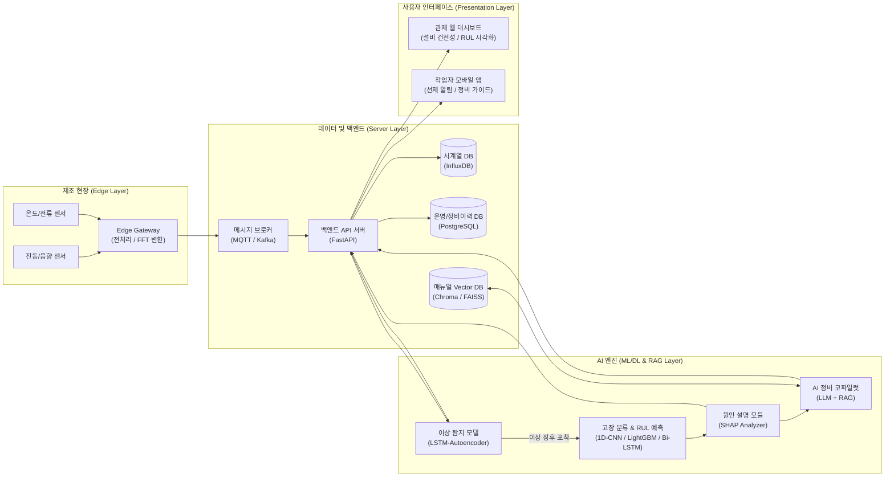

# 🏭 Codyssey Term Project — AI Smart Factory
> **7대 도메인 아이디어톤 서비스 기획안**  
> **프로젝트명**: **FactoryGuard AI (팩토리가드 AI)** — *멀티모달 센서 기반 중소 제조 설비 예지보전(PdM) 및 RAG 기반 지능형 정비 가이드 플랫폼*

---

## 📄 문서 목록
- **[AI 서비스 기획서 전문 (`smart_factory_service_proposal.md`)](./smart_factory_service_proposal.md)**

---

## 📌 프로젝트 핵심 요약

| 항목 | 내용 |
| :--- | :--- |
| **도메인** | **AI Smart Factory** |
| **해결 문제** | 중소 제조 현장의 회전 설비 돌발 고장(Downtime) 손실, 주기별 과잉 정비 비용, 숙련 보전 인력 부족 문제 |
| **타겟 사용자** | 중소·중견 제조기업 설비 보전팀 및 현장 라인 관리자 (부 타겟: 공장장·안전관리 책임자) |
| **핵심 기능** | ① 다변량 센서 실시간 건전성 모니터링(Health Index) ② 잔여 수명(RUL) 예측 및 고장 유형 분류 ③ XAI(SHAP) 기반 고장 판단 근거 시각화 ④ 설비 매뉴얼·정비 이력 기반 RAG 정비 코파일럿 |
| **적용 AI 기술** | • **전처리**: FFT / STFT 주파수 변환 • **이상 탐지**: `LSTM-Autoencoder` / `Anomaly Transformer` • **고장 분류 & RUL**: `1D-CNN + LightGBM`, `Bi-LSTM` • **설명 가능 AI & 가이드**: `SHAP`, `LLM + RAG (Vector DB)` |
| **기대 효과** | • 비계획 설비 다운타임 **30~50% 감축** • 평균 수리 시간(MTTR) **40% 이상 단축** • 유지보수 및 예비 부품 재고 비용 **20~25% 절감** |

---

## 🏗️ 시스템 아키텍처

---

## 👥 팀 역할 분담 (5인 기준)

| 담당 | 역할 | 주요 기여 내용 |
| :---: | :--- | :--- |
| **팀원 1** | **PM / 서비스 기획** | 스마트 팩토리 산업 이슈 조사, 요구사항 정의, 사용자 시나리오 및 PT 스토리라인 총괄 |
| **팀원 2** | **Data Engineer** | 다변량 센서 데이터셋 수집·정제, 슬라이딩 윈도우 및 FFT/STFT 주파수 특징 추출 파이프라인 설계 |
| **팀원 3** | **AI Modeling 1** | 정상 운전 데이터 기반 `LSTM-Autoencoder` 비지도 이상 탐지 및 건전성 지수(HI) 산출 모델링 |
| **팀원 4** | **AI Modeling 2** | `1D-CNN`/`LightGBM` 고장 원인 분류, `Bi-LSTM` 잔여 수명(RUL) 예측 및 `SHAP` 근거 추출 설계 |
| **팀원 5** | **Backend / RAG & UI** | 실시간 데이터 파이프라인 아키텍처, 설비 매뉴얼 기반 RAG 정비 코파일럿 및 관제 대시보드 UI 설계 |
