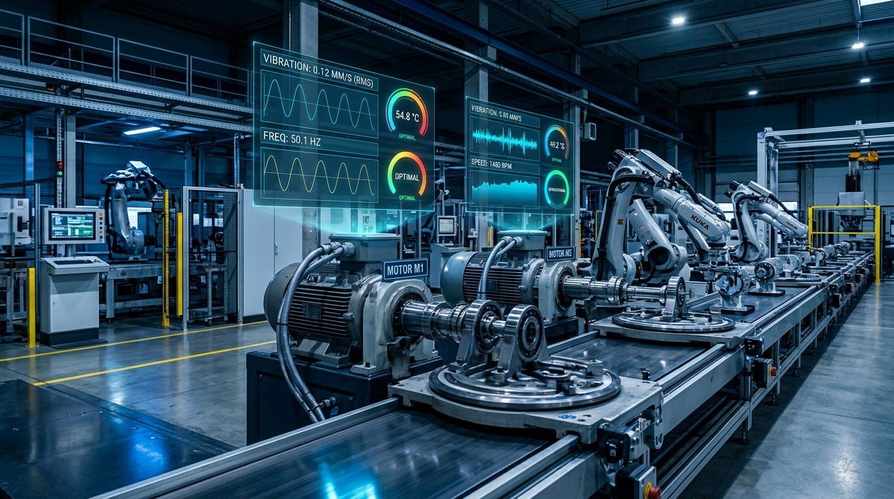
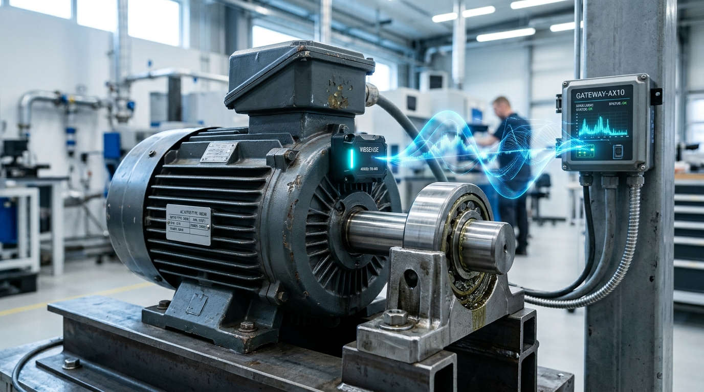
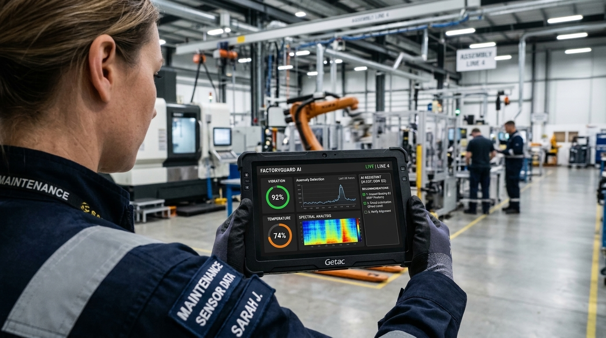
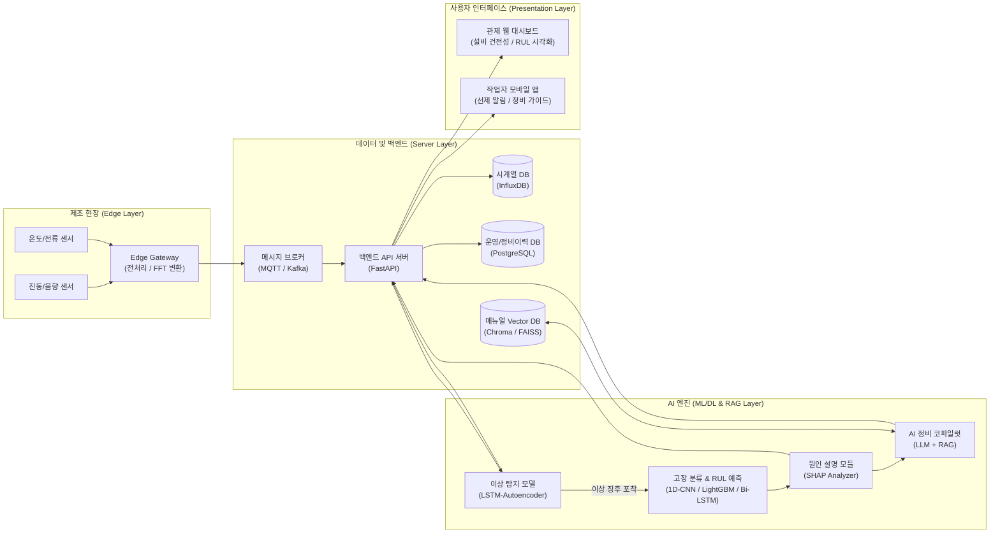

# AI 기반 중소 제조 설비 예지보전 및 지능형 정비 가이드 서비스 기획서
> **도메인**: AI Smart Factory  
> **서비스명**: **FactoryGuard AI (팩토리가드 AI)** — *멀티모달 센서 기반 설비 예지보전(PdM) 및 RAG 정비 코파일럿*



---

## 1. 문제 정의

### 1.1 산업 배경 및 현황
- **예기치 못한 설비 다운타임(Downtime)의 막대한 손실**: 제조 현장에서 핵심 회전 설비(모터, 펌프, 프레스, CNC 등)의 돌발 고장은 라인 전체 가동 중단으로 이어지며, 중소·중견 제조업체의 경우 시간당 수백만~수천만 원의 생산 차질 및 납기 지연 손실을 유발함.
- **기존 보전 방식의 한계**:
  - **사후 보전(Reactive Maintenance)**: 고장 발생 후 수리하는 방식으로, 부품 파손 확산 및 안전사고 위험이 큼.
  - **예방 보전(Preventive Maintenance, TBM)**: 실제 마모 상태와 무관하게 일정 주기마다 부품을 일괄 교체하므로, 아직 수명이 남은 부품을 폐기하는 **과잉 정비 비용(약 20~30% 낭비)**과 주기 사이의 돌발 고장을 막지 못하는 한계가 존재함.
- **숙련 보전 엔지니어 고령화 및 인력난**: 설비의 미세한 이상음이나 진동 변화를 감지하고 원인을 파악하던 베테랑 현장 기술자들이 은퇴하면서, 신규 작업자가 고장 징후를 판독하거나 즉각 조치하기 어려워짐.

### 1.2 해결하고자 하는 핵심 문제


*▲ [그림 1] 기존 중소 제조 회전 설비(모터·베어링)에 진동·음향·온도 센서를 부착하여 실시간 파형 및 주파수 스펙트럼을 추출하는 모습*

1. **멀티모달 센서(진동·음향·온도·전류) 기반 사전 고장 예측**: 설비에서 실시간 수집되는 다변량 시계열 데이터의 미세한 이상 패턴을 조기에 포착하고, **고장 발생 가능 시점(잔여 유효 수명, RUL)**을 사전 예측함.
2. **고장 원인 자동 진단 및 설명 가능성(XAI) 확보**: 단순 "이상 발생" 알람에 그치지 않고, *베어링 마모, 축 정렬 불량(Misalignment), 회전체 불평형, 과열* 등 구체적인 고장 원인과 판단 근거 센서를 시각적으로 제시함.
3. **비숙련 작업자를 위한 AI 정비 매뉴얼 자동 가이드**: 고장 징후 감지 시 해당 설비 매뉴얼과 과거 정비 이력을 기반으로 즉각적인 **점검 절차 및 조치 가이드(RAG 기반 코파일럿)**를 제공하여 평균 수리 시간(MTTR)을 단축함.

---

## 2. 주제 선택 이유

- **AI Smart Factory 도메인의 핵심 페인포인트(Pain Point)**: 스마트 팩토리 고도화 단계에서 기업들이 가장 높은 ROI(투자 대비 효용)를 체감하는 영역이 '설비 예지보전(Predictive Maintenance)'임.
- **AI 핵심 기술의 집약적 활용 가능**:
  - 고장 데이터가 극히 적은 실제 산업 현장의 특성을 반영한 **비지도/준지도 시계열 이상 탐지(Anomaly Detection)**
  - 주파수 도메인(FFT/STFT) 변환과 딥러닝/부스팅 모델을 결합한 **잔여 수명 예측(RUL) 및 고장 분류**
  - 현장 신뢰도를 높이는 **XAI(설명 가능한 AI)** 및 비정형 정비 매뉴얼을 활용하는 **LLM/RAG** 기술까지 유기적으로 연결 가능.
- **데이터 확보 및 프로토타이핑 실현 가능성**: NASA Bearing Dataset, CWRU 베어링 데이터셋, MIMII(산업용 기계 음향 데이터셋), AI Hub 제조 설비 데이터셋 등 검증된 공인 오픈 데이터가 풍부하여 향후 실제 모델 학습 및 최종 프로젝트 구현 가능성이 매우 높음.

---

## 3. 타겟 사용자

### 3.1 주요 타겟 정의
- **주 타겟 (Primary)**: 고가 장비 중심의 대규모 스마트 팩토리 솔루션 도입이 어려운 **중소·중견 제조기업의 설비 보전팀 및 현장 라인 관리자**
- **부 타겟 (Secondary)**: 공장 가동률(OEE)과 정비 예산 절감을 관리하는 **생산관리 총괄(공장장) 및 안전관리 책임자**

### 3.2 타겟 사용자 니즈(Needs) 분석
| 사용자 그룹 | 주요 고충 (Pain Points) | 핵심 니즈 (User Needs) |
| :--- | :--- | :--- |
| **현장 보전/작업자** | • 경험 부족으로 이상 징후 파악이 어려움<br>• 잦은 오경보(False Alarm)로 인한 피로감<br>• 고장 시 두꺼운 매뉴얼을 찾기 번거로움 | • 직관적인 위험도 신호등 UI (정상/주의/위험)<br>• "어느 부위를 왜 점검해야 하는지" 명확한 근거<br>• 알람 즉시 확인 가능한 단계별 정비 체크리스트 |
| **설비/생산 관리자** | • 돌발 고장으로 인한 납기 지연 및 야간 긴급 호출<br>• 예비 부품 재고 과다 또는 부족 문제 | • 설비별 잔여 수명(RUL) 예측 기반 계획 정비 스케줄링<br>• 주간/월간 설비 건전성 리포트 및 부품 발주 알림 |

---

## 4. 서비스 개요

### 4.1 서비스 정의
- **서비스명**: **FactoryGuard AI (팩토리가드 AI)**
- **한 줄 소개**: 기존 제조 설비에 부착된 센서 데이터를 실시간 분석하여 **고장 전조 증상을 사전에 예측**하고, **원인 진단부터 맞춤형 수리 가이드까지 원스톱으로 제공하는 AI 예지보전 플랫폼**


*▲ [그림 2] 현장 작업자용 태블릿 관제 대시보드(건전성 게이지, 시계열 이상 그래프, 스펙트로그램 히트맵) 및 RAG 정비 코파일럿 체크리스트 UI*

### 4.2 핵심 기능
1. **실시간 설비 건전성 모니터링 & 이상 탐지 (Health Scoring)**
   - 진동, 소음, 온도, 전류 데이터를 실시간 수집하여 설비별 **건전성 지수(Health Index, 0~100점)** 산출 및 임계치 이탈 시 즉각 알림 제공.
2. **잔여 유효 수명(RUL) 예측 및 고장 유형 분류**
   - 설비 열화 곡선을 추적하여 예상 고장 시점(예: *"약 72시간 내 베어링 내륜 마모 임계 도달 예상"*)과 고장 부위별 확률 제시.
3. **XAI 기반 고장 판단 근거 시각화**
   - SHAP 기여도 분석을 통해 "진동 센서 고주파 대역(2.5kHz) 에너지 42% 급증 및 베어링 온도 12°C 상승" 등 알람의 구체적 원인을 작업자에게 설명.
4. **RAG 기반 AI 정비 코파일럿 (Maintenance Guide)**
   - 감지된 고장 유형에 맞춰 설비 매뉴얼과 과거 수리 이력 DB를 자동 검색하여 필요한 공구, 교체 부품 번호, 안전 수칙, 단계별 조치 방법을 대화형으로 안내.
5. **정비 스케줄 최적화 및 자동 리포트 생성**
   - 생산 비가동 시간(교대 시간, 주말)과 예상 잔여 수명을 매칭하여 최적 정비 일정을 추천하고 주간/월간 설비 효율(MTBF, MTTR) 리포트 자동 생성.

### 4.3 기존 서비스 대비 차별점
| 비교 항목 | 기존 설비 모니터링 (SCADA/CMS) | 기존 대기업 예지보전 솔루션 | **FactoryGuard AI (제안 서비스)** |
| :--- | :--- | :--- | :--- |
| **탐지 방식** | 고정 임계치(Threshold) 기반 단순 경보 | 고가 전용 장비 기반 복합 분석 | **비지도 시계열 AI 기반 미세 전조 증상 사전 포착** |
| **오경보 및 설명력** | 잦은 오경보, 원인 파악 불가 | 블랙박스 모델로 현장 납득 어려움 | **XAI(SHAP) 기반 이상 원인 센서·주파수 근거 제시** |
| **사후 조치 연결** | 알람만 발생 (조치는 숙련공 의존) | 별도 컨설팅/전문 인력 필요 | **RAG 코파일럿이 매뉴얼 기반 즉각적 정비 가이드 제공** |
| **도입 장벽** | 낮음 (기능 한계 명확) | 매우 높음 (수억 원대 구축비) | **기존 설비에 IoT 센서 부착만으로 도입 가능한 경량 SaaS** |

---

## 5. AI 기술 적용 방안

### 5.1 핵심 기능별 AI/ML 기술 매핑
| 기능 모듈 | 적용 AI/ML 기술 | 기술 적용 상세 설명 | 기술 선택 이유 |
| :--- | :--- | :--- | :--- |
| **신호 전처리 및 특징 추출** | **FFT / STFT & Wavelet Transform** | 시간 축의 진동·음향 원시 신호(Raw Signal)를 주파수 및 시간-주파수 스펙트로그램 도메인으로 변환 | 회전 설비의 베어링·기어 결함은 시간 축보다 특정 고유 주파수 대역의 에너지 변화에서 가장 먼저 포착됨 |
| **실시간 이상 탐지** | **LSTM-Autoencoder / Anomaly Transformer** | 정상 운전 상태의 다변량 시계열 패턴을 학습한 뒤, 복원 오차(Reconstruction Error) 기반으로 비정상 전조 증상 탐지 | 실제 공장에서는 '고장 데이터'가 극히 희소하므로, **정상 데이터만으로 학습 가능한 비지도/준지도 학습**이 필수적임 |
| **고장 유형 분류** | **1D-CNN + LightGBM (앙상블)** | 스펙트로그램 특징(1D-CNN)과 시계열 통계 피처(RMS, 첨도, 왜도 등 - LightGBM)를 결합해 고장 원인(베어링 마모, 축 불량 등) 분류 | 딥러닝의 파형 패턴 추출 능력과 트리 기반 부스팅 모델의 정형 피처 해석력·빠른 추론 속도를 동시에 확보 |
| **잔여 수명(RUL) 예측** | **Bi-LSTM / Temporal Fusion Transformer (TFT)** | 시간에 따른 설비 건전성 지수(HI)의 열화 궤적을 학습하여 고장 임계점 도달까지의 잔여 시간 예측 | 장기 시계열 의존성을 포착하고 예측 구간의 불확실성(Confidence Interval)을 함께 제시할 수 있음 |
| **판단 근거 설명 (XAI)** | **SHAP / Grad-CAM** | 이상 점수 및 고장 분류에 기여한 상위 센서 채널과 주파수 대역의 기여도를 수치 및 히트맵으로 산출 | 현장 엔지니어가 AI 알람을 신뢰하고 즉각 점검 부위를 특정할 수 있도록 설명 가능성 부여 |
| **지능형 정비 가이드** | **LLM + RAG (Vector DB)** | 설비 PDF 매뉴얼과 과거 정비 일지를 임베딩(Embedding)하여, 감지된 고장 코드에 맞는 맞춤형 수리 절차를 생성 | 환각(Hallucination) 없이 실제 공장의 설비 사양과 과거 이력에 근거한 정확한 정비 지침 제공 가능 |

### 5.2 AI 파이프라인 흐름
1. **Data Ingestion**: 진동(가속도계), 음향, 온도, 전류 센서 데이터를 Edge Gateway에서 샘플링 및 노이즈 필터링.
2. **Feature Engineering**: 슬라이딩 윈도우 단위로 시간 영역 통계량(RMS, Kurtosis, Crest Factor) 및 주파수 영역(FFT Peak) 피처 추출.
3. **Two-Stage AI Inference**:
   - **Stage 1 (Anomaly Detection)**: `LSTM-Autoencoder`가 실시간 복원 오차를 계산하여 건전성 점수(Health Score) 산출.
   - **Stage 2 (Fault Diagnosis & RUL)**: 이상 징후 감지 시 `1D-CNN / LightGBM` 분류기와 `Bi-LSTM` RUL 모델이 작동하여 **고장 유형 + 잔여 수명 + SHAP 기여도** 도출.
4. **Actionable Guide Generation**: 진단 결과를 쿼리로 변환하여 `Vector DB`에서 관련 매뉴얼·과거 정비 이력을 검색(RAG) 후 작업자 대시보드 및 모바일로 조치 가이드 발송.

---

## 6. 예상 시스템 구성 (System Architecture)

### 6.1 텍스트 아키텍처 다이어그램
```text
┌───────────────────┐       ┌───────────────────┐       ┌─────────────────────────┐
│   제조 설비/센서   │       │   Edge Gateway    │       │     API & 수집 서버      │
│ (진동/소음/온도/전류)│──────▶│ (노이즈제거/FFT변환)│──────▶│  (FastAPI / Kafka/MQTT) │
└───────────────────┘       └───────────────────┘       └────────────┬────────────┘
                                                                     │
      ┌──────────────────────────────────────────────────────────────┼──────────────────────────────┐
      ▼                                                              ▼                              ▼
┌─────────────────────────┐                               ┌────────────────────┐          ┌────────────────────┐
│     데이터베이스 계층     │                               │   AI 추론 파이프라인 │          │  RAG 정비 코파일럿   │
│ • 시계열 DB (InfluxDB)   │◀─────────────────────────────▶│ 1. LSTM-AE 이상탐지 │─────────▶│ • LLM + Vector DB  │
│ • 정형 DB (PostgreSQL)   │                               │ 2. 고장분류 & RUL   │          │ • 설비매뉴얼/정비이력│
└─────────────────────────┘                               │ 3. SHAP 원인 분석   │          └─────────┬──────────┘
                                                          └──────────┬─────────┘                    │
                                                                     │                              │
                                                                     ▼                              ▼
                                                          ┌────────────────────────────────────────────────────┐
                                                          │           현장 작업자 & 관리자 서비스 UI             │
                                                          │ • 실시간 설비 관제 대시보드 (Web)                    │
                                                          │ • 긴급 고장 예보 알림 및 정비 체크리스트 (Mobile)     │
                                                          └────────────────────────────────────────────────────┘
```

### 6.2 상세 시스템 흐름도 (Mermaid)


---

## 7. 기대 효과

### 7.1 현장 사용자(작업자·보전팀) 관점
- **정비 의사결정 시간 및 수리 시간(MTTR) 40% 이상 단축**: 고장 원인(XAI)과 매뉴얼 기반 조치 가이드(RAG)가 함께 제공되어 비숙련 작업자도 신속하고 표준화된 초기 대응이 가능함.
- **오경보 피로도 감소 및 안전사고 예방**: 단순 임계치 알람 대비 다변량 패턴 분석으로 오경보를 줄이고, 설비 과열·파손으로 인한 현장 작업자 2차 안전사고를 예방함.
- **숙련공 노하우의 디지털 자산화**: 베테랑 기술자의 정비 기록이 Vector DB에 축적되어 조직 내 기술 전수 장벽을 해소함.

### 7.2 비즈니스(제조 기업) 관점
- **비계획 설비 다운타임(Unplanned Downtime) 30~50% 감축**: 돌발 고장을 사전에 인지하고 비가동 시간대에 계획 정비를 수행함으로써 공장 전체 설비종합효율(OEE) 극대화.
- **유지보수 및 부품 재고 비용 20~25% 절감**: 일괄 주기 교체(TBM)에서 상태 기반 정비(CBM)로 전환하여 불필요한 부품 폐기를 막고, 잔여 수명(RUL) 예측에 맞춰 적시에 부품을 발주함.
- **확장 가능한 B2B SaaS 비즈니스 모델**: 초기 고가 구축비 없이 월 구독형(설비 대수 기반 과금) 모델 및 향후 설비 보험사·부품 공급망(SCM) 연계 부가 비즈니스로 확장 가능.

---

## 8. 향후 발전 방향 (Roadmap)

### 8.1 단계별 서비스 확장 계획
- **1단계 (MVP 개발 및 검증 - 현재 프로젝트 목표)**
  - 공인 회전 설비 데이터셋(NASA/CWRU Bearing, MIMII 음향 데이터 등) 기반 이상 탐지 및 고장 분류 모델 구현
  - SHAP 기반 이상 원인 시각화 대시보드 및 설비 매뉴얼 PDF 연동 RAG 정비 챗봇 프로토타입 구축
- **2단계 (현장 실증 및 Edge AI 경량화)**
  - 실제 제조 현장 IoT 센서 데이터 연동 및 공장별 설비 특성에 맞춘 **전이 학습(Transfer Learning) / 소수 샷 적응(Few-shot Adaptation)** 파이프라인 도입
  - 통신 지연 및 보안 이슈 해결을 위해 이상 탐지 모델을 경량화(ONNX/TensorRT)하여 Edge 디바이스 내 실시간 추론 탑재
- **3단계 (자율형 스마트 팩토리 생태계 확장)**
  - **ERP / MES / SCM 시스템 연동**: 잔여 수명(RUL)이 임계치 이하로 떨어질 경우 예비 부품 자동 발주 및 정비 작업 지시서(Work Order) 자동 발행
  - **디지털 트윈(Digital Twin) 결합**: 3D 가상 공장 환경에 설비별 건전성 지수와 열화 시뮬레이션을 연동하여 공정 전체의 생산 스케줄 자율 최적화

---

## 9. 팀 역할 분담 및 협업 계획 (5인 기준)

| 역할 (담당자) | 주요 담당 영역 | 세부 기여 및 수행 내용 |
| :--- | :--- | :--- |
| **팀원 1 (PM / 서비스 기획)** | **프로젝트 총괄 및 도메인 리서치** | • 스마트 팩토리 산업 현황 및 중소 제조 현장 페인포인트 조사<br>• 서비스 요구사항 정의, 사용자 시나리오 설계, 발표 자료(PT) 스토리라인 총괄 |
| **팀원 2 (Data Engineer)** | **센서 데이터 수집 및 신호 전처리** | • 회전 설비 다변량 시계열 데이터셋(진동·음향·온도) 수집 및 정제<br>• 슬라이딩 윈도우 분할, 시간 통계 피처 및 FFT/STFT 주파수 특징 추출 파이프라인 구축 |
| **팀원 3 (AI Modeling 1)** | **비지도 이상 탐지 모델링** | • 정상 데이터 기반 `LSTM-Autoencoder` / `Anomaly Transformer` 설계 및 학습<br>• 복원 오차 기반 설비 건전성 지수(Health Index) 산출 및 동적 임계치 최적화 |
| **팀원 4 (AI Modeling 2)** | **고장 원인 분류, RUL 예측 및 XAI** | • `1D-CNN` / `LightGBM` 기반 고장 유형 분류 및 `Bi-LSTM` 잔여 수명(RUL) 예측 모델 설계<br>• `SHAP` 기반 고장 판단 근거(센서·주파수 기여도) 추출 로직 설계 |
| **팀원 5 (Backend / RAG & UI)** | **시스템 아키텍처 및 RAG·대시보드 설계** | • 전체 시스템 아키텍처 및 실시간 데이터 흐름(FastAPI/DB) 설계<br>• 설비 매뉴얼 기반 RAG 정비 코파일럿 구조 및 실시간 관제 대시보드 UI/UX 프로토타입 설계 |

> **팀 협업 원칙**:
> 1. **전원 기획 참여**: 문제 정의와 타겟 니즈 분석, AI 기술 선정 과정은 5인 전원이 브레인스토밍과 교차 검증을 통해 공동 수립함.
> 2. **도메인-기술 정합성 검증**: 매주 정기 스크럼을 통해 "현장 작업자가 실제로 쓸 수 있는가?"(기획/UI)와 "실제 데이터로 학습·추론이 가능한가?"(데이터/AI)를 상호 피드백함.

---

## 10. [부록] 발표 자료(PPT/PDF) 구성 가이드 (10장 내외 권장)

발표 자료 제작 시 아래 슬라이드 구성을 활용하면 평가 항목(과제 목표 6가지)을 완벽하게 충족할 수 있습니다.

1. **표지**: 프로젝트명(*FactoryGuard AI*), 도메인(AI Smart Factory), 팀명 및 팀원 소개
2. **산업 현황 및 문제 배경**: 제조 설비 돌발 다운타임의 손실 규모, 기존 사후/예방 보전의 한계, 숙련공 감소 이슈
3. **해결하고자 하는 문제 & 주제 선택 이유**: 왜 중소 제조 설비 예지보전인가? (명확한 ROI + 시계열 AI/XAI/RAG 기술 시너지)
4. **타겟 사용자 및 페르소나 분석**: 현장 보전 작업자 vs 생산/설비 관리자의 핵심 고충과 니즈
5. **서비스 개요 (FactoryGuard AI)**: 핵심 기능 4가지(이상 탐지, 고장 분류 & RUL, XAI 근거 제시, RAG 정비 가이드) 및 기존 솔루션 대비 차별점 비교표
6. **AI 기술 적용 방안 (핵심 슬라이드)**: FFT 전처리 → LSTM-AE 이상 탐지 → 1D-CNN/LightGBM 고장 분류 & Bi-LSTM RUL → SHAP & RAG 파이프라인과 기술 선택 이유
7. **시스템 아키텍처 & 화면 구성안**: Edge 센서부터 AI 서버, 작업자 대시보드/모바일 알림으로 이어지는 아키텍처 다이어그램
8. **기대 효과**: 사용자 관점(MTTR 단축, 오경보 감소, 안전 확보) 및 비즈니스 관점(다운타임 30~50% 감축, 정비 비용 절감)
9. **향후 발전 방향 (Roadmap)**: 1단계(MVP/오픈데이터 검증) → 2단계(Edge AI 경량화/전이학습) → 3단계(ERP·MES 연동 및 디지털 트윈)
10. **팀 역할 분담 및 회고**: 5인 각자의 담당 영역, 기획 기여도, 협업 과정에서 배운 점
